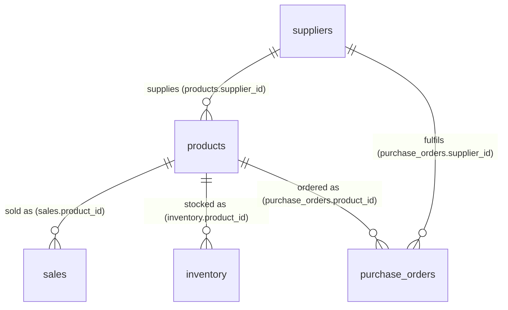

# Databricks: `workspace.smartstock_retail`

Delta table definitions for SmartStock AI. These scripts are **run manually** in the Databricks
SQL editor against your own workspace. Nothing in this repository runs them automatically.

- **Catalog:** `workspace` (existing; never created or modified here)
- **Schema:** `smartstock_retail` (must already exist; these scripts do not create it)
- **Compute:** any SQL Warehouse (developed against the Serverless Starter Warehouse)
- **Credentials:** none in these files. The editor uses your signed-in session.

## Tables

| Table | Grain (one row per…) | Purpose |
|---|---|---|
| `suppliers` | supplier | Vendors that replenish stock, with lead time, minimum order quantity, and on-time reliability. |
| `products` | product | Product catalogue: SKU, category, cost, regular price, shelf life, and primary supplier. |
| `sales` | store × product × day | Units sold and the price actually paid. This is the demand history used for forecasting. |
| `inventory` | store × product × day | End-of-day stock snapshot with reserved units, reorder point, and safety stock. |
| `purchase_orders` | order line | Replenishment orders: what was ordered, from whom, for which store, and when it arrived. |

## Relationships

- `store_id` appears in `sales`, `inventory`, and `purchase_orders` but has **no `stores` table yet**,
  so it has no foreign key.
- `inventory` should have at most one row per `(snapshot_date, store_id, product_id)`. Databricks
  has no UNIQUE constraint, so the load step must enforce this.
- Inventory balances day over day:
  `on_hand(d) = on_hand(d-1) + delivered(d) - sold(d)`, where `delivered(d)` is the sum of
  `purchase_orders.quantity_ordered` with `actual_delivery_date = d` for that store and product.
  The synthetic generator follows this rule, and `backend/tests` checks it.

## Constraints

| Kind | Where | Enforced? |
|---|---|---|
| `NOT NULL` | column definitions | **Yes**: writes with NULLs are rejected |
| `PRIMARY KEY` / `FOREIGN KEY` | `CREATE TABLE` | **No**: informational in Unity Catalog (documents the model and helps the optimizer) |
| `CHECK` | `06_add_check_constraints.sql` | **Yes**: violating writes are rejected |

Nullable columns: `products.shelf_life_days` (NULL means non-perishable) and
`purchase_orders.actual_delivery_date` (NULL until `order_status = 'DELIVERED'`).

## Run order

Open each file in **SQL Editor**, select your SQL Warehouse, and click **Run all**.

| # | File | Changes anything? |
|---|---|---|
| 00 | `00_preflight_check.sql` | No (read-only): confirms the schema exists |
| 01 | `01_create_suppliers.sql` | Creates the table if it is missing |
| 02 | `02_create_products.sql` | Creates the table if it is missing (FK → suppliers) |
| 03 | `03_create_sales.sql` | Creates the table if it is missing (FK → products) |
| 04 | `04_create_inventory.sql` | Creates the table if it is missing (FK → products) |
| 05 | `05_create_purchase_orders.sql` | Creates the table if it is missing (FK → suppliers, products) |
| 06 | `06_add_check_constraints.sql` | Drops and re-adds the named CHECK constraints (tables and data untouched) |
| 07 | `07_verify_tables.sql` | No (read-only): lists tables, keys, columns, and constraints |

Order matters: a foreign key can only reference a table that already exists.

## Rerunning

- `CREATE TABLE IF NOT EXISTS` does nothing when the table exists. It **will not apply column
  changes** to an existing table, so later schema changes should be new numbered `ALTER TABLE` scripts.
- `06` can be rerun safely. Adding a CHECK constraint checks the rows already in the table, so it
  fails if existing data breaks the rule. That is intended.
- No script uses `DROP TABLE`, `CREATE OR REPLACE`, `TRUNCATE`, `INSERT`, `CREATE CATALOG`,
  `CREATE SCHEMA`, or `LOCATION`. `backend/tests/test_databricks_sql.py` checks this.

## Data types

- IDs are readable `STRING` business keys (`SUP-0001`, `PRD-00001`, `STR-001`, …).
- Money is `DECIMAL(10,2)`, never floating point. `reliability_score` is `DECIMAL(4,3)`.
- `sales`, `inventory`, and `purchase_orders` use **liquid clustering** (`CLUSTER BY`) on date
  and store, the most common filters for forecasting and replenishment queries.
